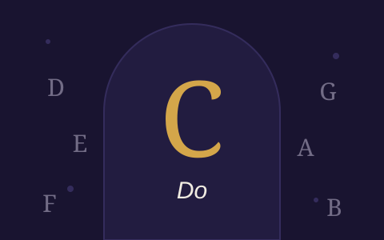

# Do es C



**Clave americana y nombres latinos** · paso 1 del recorrido · teoría · 4 min · dificultad fácil

Las notas se escriben con letras en todo el mundo. Aprende a pasar de C D E a Do Re Mi y de vuelta.

## Objetivo

Leer y escribir las notas en clave americana (C, D, E, F, G, A, B, con # y b) y decir su nombre latino.

## Contenido

1. **Siete letras.** C D E F G A B se dicen Do Re Mi Fa Sol La Si. Es la notación que se usa en todo el mundo: cifrados, canciones, apps.
2. **Sostenido y bemol.** # se dice sostenido y sube medio tono (C# = Do sostenido). b se dice bemol y baja medio tono (Bb = Si bemol).
3. **Un círculo de siete.** Después de G vuelve A, y antes de A viene G: el alfabeto musical tiene solo siete letras y da la vuelta.
4. **Se escribe en letras, se dice en español.** En Acordia siempre escribimos en clave americana. Al hablar, puedes decirla con su nombre latino.

## Actividad

Diez preguntas: de letra a nombre latino, de nombre a letra y qué letra viene antes o después.

## Evaluación

Retroalimentación inmediata con la nota en el teclado y su sonido; al final, el puntaje y un repaso de los errores.

## Prerrequisitos

- Ninguno: es el primer juego del recorrido.

Prepara para: [El misterio de E#](../lo-intervals/README.md).

## Uso

```js
import { mount } from "@saul-music/lo-american-notation";
import metadata from "@saul-music/lo-american-notation/metadata.json";
import "@saul-music/lo-kit/kit.css";
import "@saul-music/lo-american-notation/style.css";

const unmount = mount(document.getElementById("juego"), { sampler, sfx, metadata, cover, next });
```

Todo es opcional salvo `metadata`: `sampler` es la música (sin él, el juego funciona en silencio; el
playground usa `createSampler` de `@saul-music/audio` con las muestras de guitarra de nailon), `sfx` los efectos
de juego (`createSfx`), `cover` la portada de la pantalla de título y `next` (`{ title, go }`) el botón «Siguiente»
de la pantalla de resultados. El récord y las estrellas se guardan en el navegador (`localStorage`).

## Estructura

- `metadata.json`: metadatos (subconjunto de IEEE LOM) y componentes pedagógicos.
- `src/theory.js`: lógica pura de las preguntas, probada en `test/` con Vitest.
- `src/index.js`: la vista (tarjeta, figura y sonido) sobre el cuestionario de `@saul-music/lo-kit`.
- `cover.svg`: portada de la galería.

## Licencia

CC BY 4.0, © 2026 Acordia (SAÚL música): puedes usarlo y adaptarlo dando crédito. Ver [`NOTICE.md`](../../NOTICE.md) y [`LICENSE`](../../LICENSE).
