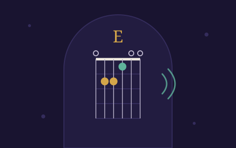

# Manos de acorde



**Formas de acordes en la guitarra** · paso 6 del recorrido · guitarra · 6 min · dificultad media

Cada acorde tiene su forma en el mástil. Reconoce las formas de los acordes mayores, menores y de séptima, y qué nota suena en cada cuerda.

## Objetivo

Reconocer las formas de guitarra de los acordes mayores, menores y de séptima, y decir qué nota del acorde suena en cada cuerda.

## Contenido

1. **Cómo se lee un diagrama.** Las líneas verticales son las cuerdas (la 6ª a la izquierda) y las horizontales, los trastes. Los puntos son los dedos; ○ es cuerda al aire y × no se toca.
2. **Una forma, tres notas.** Toda forma de acorde repite, en distintas cuerdas, solo las notas del acorde: la 1ª, la 3ª y la 5ª (y la 7ª en los de séptima).
3. **Un dedo cambia el color.** De E a Em solo cambia la 3ª: G# baja a G. De E a E7 se suma la 7ª: aparece D.
4. **Cejilla.** Una barra sobre varias cuerdas es una cejilla: el índice las aprieta todas en el mismo traste. Así una misma forma sirve para varios acordes.

## Actividad

Diez preguntas: qué acorde es una forma, cuál es la forma de un acorde y qué nota suena en una cuerda marcada.

## Evaluación

Retroalimentación inmediata con las notas del acorde y su sonido rasgueado; al final, el puntaje y un repaso de los errores.

## Prerrequisitos

- [Escalera del acorde](../lo-arpeggios/README.md): la 1ª, la 3ª y la 5ª de los acordes mayores y menores.

Prepara para: [Pulso](../lo-strum-rhythm/README.md).

## Uso

```js
import { mount } from "@saul-music/lo-chord-shapes";
import metadata from "@saul-music/lo-chord-shapes/metadata.json";
import "@saul-music/lo-kit/kit.css";
import "@saul-music/lo-chord-shapes/style.css";

const unmount = mount(document.getElementById("juego"), { sampler, sfx, metadata, cover, next });
```

Todo es opcional salvo `metadata`: `sampler` es la música (sin él, el juego funciona en silencio; el
playground usa `createSampler` de `@saul-music/audio` con las muestras de guitarra de nailon), `sfx` los efectos
de juego (`createSfx`), `cover` la portada de la pantalla de título y `next` (`{ title, go }`) el botón «Siguiente»
de la pantalla de resultados. El récord y las estrellas se guardan en el navegador (`localStorage`).

## Estructura

- `metadata.json`: metadatos (subconjunto de IEEE LOM) y componentes pedagógicos.
- `src/theory.js`: lógica pura de las preguntas, probada en `test/` con Vitest.
- `src/index.js`: la vista (tarjeta, figura y sonido) sobre el cuestionario de `@saul-music/lo-kit`.
- `cover.svg`: portada de la galería.
- `data/chords.json`: subconjunto de chords-db (MIT, ver `data/LICENSE-chords-db.txt`).

## Licencia

CC BY 4.0, © 2026 Acordia (SAÚL música): puedes usarlo y adaptarlo dando crédito. Ver [`NOTICE.md`](../../NOTICE.md) y [`LICENSE`](../../LICENSE).
