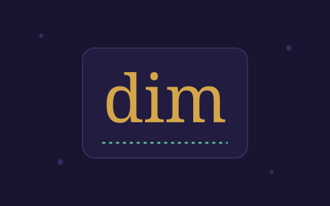

# Disminuidos y aumentados

**Tríadas con la 5ª alterada** · teoría · 5 min

Si la 5ª de un acorde baja medio tono, es disminuido (dim); si sube, aumentado (aug). Aprende cómo se forman a partir del menor y del mayor.

## Objetivo

Formar los acordes disminuidos y aumentados alterando la 5ª del menor y del mayor, y reconocerlos por sus notas.

## Contenido

1. **Disminuido.** Como el menor (1 – 3m), pero con la 5ª disminuida: medio tono más abajo. Cdim = C – E♭ – G♭.
2. **Aumentado.** Como el mayor (1 – 3M), pero con la 5ª aumentada: medio tono más arriba. Caug = C – E – G♯.
3. **Cómo se escriben.** Con el sufijo dim y aug (a veces también con + para el aumentado).
4. **La ortografía.** Algunas notas llevan nombres menos comunes (E aug es E – G♯ – B♯): la letra sigue el orden 1ª, 3ª, 5ª.

## Actividad

Diez preguntas: reconocer el acorde por sus notas, decir la 5ª de un dim o un aug y qué cambia al pasar del mayor al aumentado o del menor al disminuido.

## Licencia

CC BY 4.0, con crédito a Acordia (SAÚL música).
