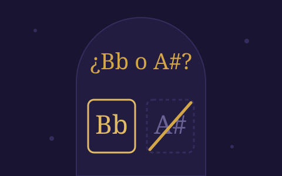

# Nombra bien la nota



**Por qué casi nunca ves E#, B#, Fb ni Cb, y cuándo usar bemoles** · paso 3 del recorrido · teoría · 6 min · dificultad media

Cada letra una sola vez: escribe las notas como las escribiría un músico y elige sostenido o bemol con criterio.

## Objetivo

Escribir las notas de una tonalidad mayor con la letra correcta, elegir entre sostenido y bemol con un criterio simple y explicar por qué casi nunca se usan E#, B#, Fb y Cb.

## Contenido

1. **Cada letra, una vez.** Una escala mayor usa las siete letras, cada una una sola vez y en orden. En F mayor la cuarta nota es una B: se escribe Bb, no A#, porque la A ya está usada.
2. **El nombre sigue a la tonalidad.** Las tonalidades con sostenidos (G, D, A) usan sostenidos y las de bemoles (F, Bb, Eb) usan bemoles. Si dudas, el bemol suele ser la opción más cómoda: Bb, Eb y Ab son muy comunes.
3. **Las notas raras.** E# suena como F, B# como C, Fb como E y Cb como B. Solo aparecen cuando la tonalidad las pide: E# en F# mayor, Cb en Gb mayor, B# en C# mayor y Fb en Cb mayor.
4. **Elige el nombre simple.** Fuera de esas tonalidades, entre E y F y entre B y C no hay tecla negra: la nota que sigue es F o C, no E# ni B#.
5. **Los acordes también.** Un acorde mayor usa letras alternadas: Bb mayor es Bb D F, no A# D F. Si el acorde suena bien pero se ve raro, probablemente esté mal escrito.

## Actividad

Diez preguntas de cuatro tipos: escribir la nota de una escala, elegir el nombre simple al subir o bajar medio tono, encontrar la tonalidad de una nota rara y escribir un acorde.

## Evaluación

Retroalimentación inmediata con la escala dibujada y el sonido; la explicación dice qué letra estaba ya usada. Al final, puntaje y repaso de errores.

## Prerrequisitos

- [El misterio de E#](../lo-intervals/README.md): medios tonos, sostenidos y por qué existen notas como E#.

Prepara para: [Eco en el mástil](../lo-fretboard-notes/README.md).

## Uso

```js
import { mount } from "@saul-music/lo-enharmonic-spelling";
import metadata from "@saul-music/lo-enharmonic-spelling/metadata.json";
import "@saul-music/lo-kit/kit.css";
import "@saul-music/lo-enharmonic-spelling/style.css";

const unmount = mount(document.getElementById("juego"), { sampler, sfx, metadata, cover, next });
```

Todo es opcional salvo `metadata` (ver [El misterio de E#](../lo-intervals/README.md#uso) para el detalle de `sampler`, `sfx`, `cover` y `next`).

## Estructura

- `metadata.json`: metadatos (subconjunto de IEEE LOM) y componentes pedagógicos.
- `src/theory.js`: lógica pura de las preguntas, probada en `test/` con Vitest.
- `src/index.js`: la vista (tarjeta, escala y sonido) sobre el cuestionario de `@saul-music/lo-kit`.
- `cover.svg`: portada de la galería.

## Licencia

CC BY 4.0, © 2026 Acordia (SAÚL música): puedes usarlo y adaptarlo dando crédito. Ver [`NOTICE.md`](../../NOTICE.md) y [`LICENSE`](../../LICENSE).
