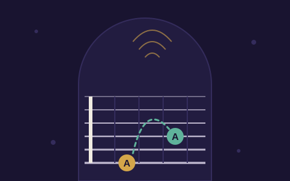

# Eco en el mástil



**La misma nota en otra cuerda** · paso 3 del recorrido · guitarra · 5 min · dificultad fácil

La misma nota vive en varias cuerdas. Ves una en el mástil y la buscas en otra cuerda.

## Objetivo

Ubicar en cualquier cuerda la misma nota que ves en otra, entre los trastes 0 y 12, y reconocer si suena igual o una octava más aguda o más grave.

## Contenido

1. **Clave americana.** Las notas se escriben con letras, como en todo el mundo. En español puedes decirlas con su nombre latino.
2. **Medio tono por traste.** Cada traste sube medio tono. Entre dos letras vecinas hay una nota con sostenido (C, C#, D…), salvo entre E y F y entre B y C. En el traste 12 vuelve la nota de la cuerda al aire, una octava más aguda.
3. **La regla del traste 5.** El traste 5 de una cuerda suena igual que la cuerda vecina más aguda al aire (6ª en 5 = 5ª al aire). La excepción es la 3ª: se iguala con la 2ª en el traste 4.
4. **Una nota, muchos lugares.** La misma nota aparece en varias cuerdas: a veces con el mismo sonido exacto (unísono), a veces una o más octavas arriba o abajo.

## Actividad

Diez preguntas: se marca una nota en el mástil y se pide tocarla en otra cuerda.

## Evaluación

Retroalimentación inmediata con la posición correcta, el sonido de ambas notas y su relación de octava; al final, el puntaje y un repaso de los errores.

## Prerrequisitos

- [El misterio de E#](../lo-intervals/README.md): medios tonos, sostenidos y por qué existen notas como E#.

Prepara para: —.

## Uso

```js
import { mount } from "@saul-music/lo-fretboard-notes";
import metadata from "@saul-music/lo-fretboard-notes/metadata.json";
import "@saul-music/lo-kit/kit.css";
import "@saul-music/lo-fretboard-notes/style.css";

const unmount = mount(document.getElementById("juego"), { sampler, metadata });
```

`sampler` es opcional (sin él, el juego funciona en silencio); el playground usa `createSampler` de
`@saul-music/audio` con las muestras de guitarra de nailon.

## Estructura

- `metadata.json`: metadatos (subconjunto de IEEE LOM) y componentes pedagógicos.
- `src/theory.js`: lógica pura de las preguntas, probada en `test/` con Vitest.
- `src/index.js`: el mástil interactivo, sobre las piezas de `@saul-music/lo-kit` (intro, avance, efectos y resumen).
- `cover.svg`: portada de la galería.
