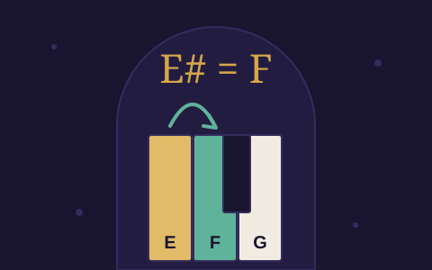

# El misterio de E#



**Intervalos, sostenidos, bemoles y notas raras** · paso 2 del recorrido · teoría · 6 min · dificultad media

¿Por qué existe E# si suena como F? Medios tonos, enarmonía, intervalos y el secreto de las escalas.

## Objetivo

Contar medios tonos, reconocer notas enarmónicas, nombrar intervalos básicos y explicar por qué existen notas como E#, B#, Fb y Cb.

## Contenido

1. **Medio tono.** Es la distancia más corta: la tecla vecina en el piano o el traste vecino en la guitarra. Dos medios tonos hacen un tono.
2. **Sin tecla negra.** Entre E y F, y entre B y C, no hay tecla negra: están a medio tono. Por eso E# cae en F, B# en C, Fb en E y Cb en B.
3. **Dos nombres, un sonido.** C# y Db son la misma tecla: notas enarmónicas. Suenan igual; cambia cómo se escriben.
4. **Intervalos.** La distancia entre dos notas: 2ª menor (1 semitono), 2ª mayor (2), 3ª menor (3), 3ª mayor (4), 4ª justa (5), 5ª justa (7), 6ª mayor (9), 8ª (12).
5. **¿Por qué existen las notas raras?** En una escala cada letra aparece una sola vez. F# mayor es F# G# A# B C# D# E#: la 7ª tiene que ser una E, y suena en F. Por eso se escribe E#.

## Actividad

Diez preguntas de cinco tipos: medio tono arriba o abajo, enarmonía, contar semitonos, nombrar el intervalo y escribir una nota de una escala.

## Evaluación

Retroalimentación inmediata con el teclado, los pasos cromáticos y el sonido; al final, el puntaje y un repaso de los errores.

## Prerrequisitos

- [Do es C](../lo-american-notation/README.md): leer las notas en clave americana, con # y b.

Prepara para: [Eco en el mástil](../lo-fretboard-notes/README.md), [Escalera del acorde](../lo-arpeggios/README.md).

## Uso

```js
import { mount } from "@saul-music/lo-intervals";
import metadata from "@saul-music/lo-intervals/metadata.json";
import "@saul-music/lo-kit/kit.css";
import "@saul-music/lo-intervals/style.css";

const unmount = mount(document.getElementById("juego"), { sampler, sfx, metadata, cover, next });
```

Todo es opcional salvo `metadata`: `sampler` es la música (sin él, el juego funciona en silencio; el
playground usa `createSampler` de `@saul-music/audio` con las muestras de guitarra de nailon), `sfx` los efectos
de juego (`createSfx`), `cover` la portada de la pantalla de título y `next` (`{ title, go }`) el botón «Siguiente»
de la pantalla de resultados. El récord y las estrellas se guardan en el navegador (`localStorage`).

## Estructura

- `metadata.json`: metadatos (subconjunto de IEEE LOM) y componentes pedagógicos.
- `src/theory.js`: lógica pura de las preguntas, probada en `test/` con Vitest.
- `src/index.js`: la vista (tarjeta, figura y sonido) sobre el cuestionario de `@saul-music/lo-kit`.
- `cover.svg`: portada de la galería.

## Licencia

CC BY 4.0, © 2026 Acordia (SAÚL música): puedes usarlo y adaptarlo dando crédito. Ver [`NOTICE.md`](../../NOTICE.md) y [`LICENSE`](../../LICENSE).
