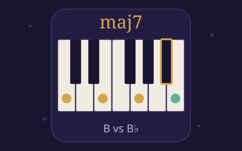

# maj7 y acordes de 6

**Dos colores luminosos** · teoría · 6 min

Aprende la 7ª mayor y la 6ª: en qué se diferencian del 7, qué notas llevan maj7, 6 y m6 y por qué C6 suena como Am7.

## Objetivo

Distinguir maj7, 7, m7, 6 y m6 por sus notas y por su sonido.

## Contenido

1. **7 o maj7.** Solo cambia una nota, por medio tono: Bb en el 7, B en el maj7.
2. **Los de 6.** Un acorde de 6 suma la 6ª al mayor (C6) o al menor (Am6).
3. **Mismas notas.** C6 y Am7 tienen las mismas notas; cambia cuál es la más grave.
4. **Resumen.** maj7, 7, m7, 6 y m6 son cinco recetas sobre la misma triada.

## Actividad

Diez preguntas: las notas de cada acorde, qué acorde forman unas notas, qué nota cambia entre dos acordes, qué acorde tiene las mismas notas y de oído.

## Licencia

CC BY 4.0, con crédito a Acordia (SAÚL música).
