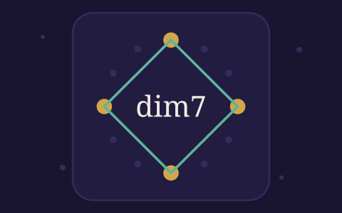

# Acordes de paso

**dim7, m7b5, aug y mmaj7** · teoría · 6 min

Aprende los acordes tensos que unen a otros: cómo se arman dim7, m7b5, aug y mmaj7 y por qué algunos suenan igual con otro nombre.

## Objetivo

Armar y reconocer dim7, m7b5, aug y mmaj7, y explicar su simetría.

## Contenido

1. **dim7.** Apila terceras menores: cada 3 semitonos. Se repite cada 3 trastes.
2. **m7b5.** Un m7 con la 5ª bajada medio tono.
3. **aug.** Apila terceras mayores: cada 4 semitonos. Se repite cada 4 trastes.
4. **mmaj7.** Menor con 7ª mayor: misterioso.

## Actividad

Diez preguntas: las notas de cada acorde, qué acorde forman unas notas, qué nota cambia, cada cuántos semitonos se repiten, qué acorde suena igual y de oído.

## Licencia

CC BY 4.0, con crédito a Acordia (SAÚL música).
