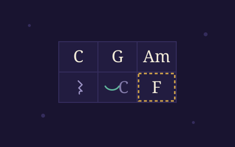

# Lee los compases

**La grilla de un tema** · teoría · 6 min

Aprende a leer la grilla de acordes de un tema como la ve quien toca: cuánto dura cada acorde, en qué orden se lee y qué dicen el arco, el gris, el silencio, la clave de tiempo y el × 2.

## Objetivo

Leer la grilla de acordes de un tema: cuánto dura cada acorde, en qué orden se lee y qué significan el arco, el gris, el silencio, la clave de tiempo y el × 2.

## Contenido

1. **Una casilla, un compás.** Un acorde solo ocupa todo el compás; dos o más se reparten el ancho y los tiempos.
2. **El orden.** Por filas, de izquierda a derecha, y luego la fila de abajo.
3. **Arco, gris y silencio.** El arco liga, el gris repite el compás anterior, el ícono es silencio.
4. **Secciones y clave de tiempo.** El × 2 toca la sección dos veces; el 4/4 o 3/4 dice cuántos tiempos tiene cada compás.

## Actividad

Diez preguntas, una de ellas de oído: elegir qué casilla es la que suena.

## Nota

La escritura de partituras con la notación de Acordia es trabajo del equipo editorial. Ese juego (`lo-read-chart`) quedó archivado.

## Licencia

CC BY 4.0, con crédito a Acordia (SAÚL música).
