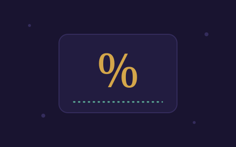

# Lee la partitura

**Compases, %, _ , . y x2** · teoría · 6 min

Aprende a leer una línea de acordes de Acordia: el compás, el guion que lo parte, el % que repite, el _ que liga, el . que calla y el x2 que repite la sección.

## Objetivo

Leer una línea de acordes básica: cuánto dura cada acorde en el compás y qué significan %, _, . y x2.

## Contenido

1. **El compás.** Cada espacio separa un compás. Un acorde solo dura todo el compás (4 tiempos en 4/4).
2. **El guion.** Parte el compás en partes iguales: C-G son dos acordes de 2 tiempos; C-G-Am-F, uno por tiempo.
3. **% y _.** El % solo repite el compás anterior; dentro de un compás alarga el acorde anterior. El _ liga: el acorde sigue sonando sin volver a tocarlo.
4. **El . y el x2.** El . es un silencio. El x2 al lado del título toca toda la sección dos veces.

## Actividad

Diez preguntas: qué acorde suena donde hay un %, cuántos tiempos dura un acorde, cuántos tiempos suenan en un compás con silencio, cuántos compases tiene una sección repetida y qué significa cada símbolo.

## Licencia

CC BY 4.0, con crédito a Acordia (SAÚL música).
