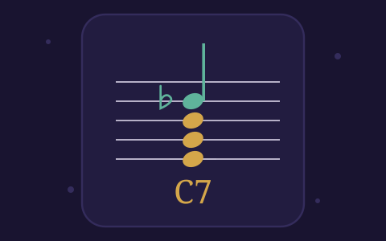

# Séptimas

**El 7 y el m7** · teoría · 6 min

Aprende cómo se arman el 7 y el m7: qué nota suman al acorde de siempre, cómo suenan y por qué un 7 pide resolver.

## Objetivo

Armar y reconocer acordes con 7 y m7, y explicar por qué un acorde con 7 apunta a otro.

## Contenido

1. **Una nota más.** El 7 y el m7 suman la 7ª menor (10 semitonos sobre la raíz).
2. **7 y m7.** El 7 es mayor con 7ª menor; el m7, menor con 7ª menor.
3. **Resolver.** El 7 apunta a un acorde una 4ª arriba: G7 va a C.
4. **Cómo se leen.** Un 7 sin más lleva la 7ª menor; la mayor se escribe «maj7».

## Actividad

Diez preguntas: las notas de cada acorde, qué acorde forman unas notas, qué nota se suma, a cuál resuelve un 7 y de oído.

## Licencia

CC BY 4.0, con crédito a Acordia (SAÚL música).
