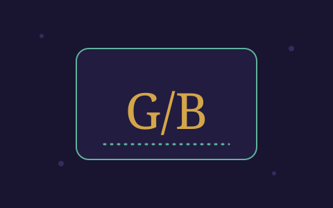

# Acordes con bajo

**G/B y D/F#** · teoría · 6 min

Aprende qué significa la barra de G/B: el acorde es G y la nota más grave es B. Reconoce el bajo, su lugar en el acorde y cómo camina.

## Objetivo

Leer un acorde con bajo (X/Y), decir qué nota va abajo y qué lugar ocupa en el acorde.

## Contenido

1. **La barra.** G/B se lee «G sobre B»: el acorde es G y el bajo es B.
2. **El bajo no es la raíz.** Las notas son las mismas; cambia cuál suena más grave.
3. **Para qué sirven.** Un bajo que baja de grado en grado conecta acordes: C, G/B, Am, Am/G.
4. **Si no llegas.** Puedes tocar el acorde sin el bajo; pierdes la línea, no la armonía.

## Actividad

Diez preguntas: qué nota va en el bajo, qué lugar ocupa en el acorde, qué acorde forman unas notas con su bajo y cuál sigue en una línea de bajo.

## Licencia

CC BY 4.0, con crédito a Acordia (SAÚL música).
