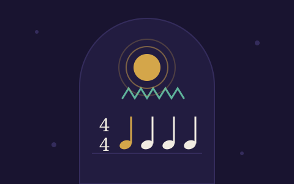

# Pulso



**Figuras del rasgueo y la regla del compás** · paso 7 del recorrido · oído · 5 min · dificultad fácil

Redonda, blancas o negras: escucha cuántos golpes da la guitarra en cada compás y aprende la regla con que Acordia rasguea los acordes.

## Objetivo

Reconocer de oído si un rasgueo va en redonda, blancas, negras o blanca con punto, y decidir cómo se rasguea un compás según cuántos acordes tiene.

## Contenido

1. **El pulso.** Es el latido parejo de la música. Cada latido es un tiempo: 4/4 tiene 4 tiempos por compás y 3/4 tiene 3.
2. **Las figuras.** La redonda dura 4 tiempos, la blanca 2 y la negra 1. El punto suma la mitad: la blanca con punto dura 3.
3. **La regla del rasgueo.** Un acorde en el compás: un golpe al inicio que dura todo el compás. Dos acordes de medio compás: un golpe al empezar cada uno (blancas). Más acordes: un golpe por tiempo (negras).
4. **Escucha el clic.** El metrónomo marca cada tiempo y suena más agudo en el 1. Cuenta los golpes de guitarra entre un 1 y el siguiente.

## Actividad

Diez preguntas: escuchar un rasgueo con metrónomo y reconocer la figura, aplicar la regla a un compás con acordes y contar tiempos.

## Evaluación

Retroalimentación inmediata con el compás dibujado, las figuras en cada golpe y el sonido; al final, el puntaje y un repaso de los errores.

## Prerrequisitos

- [Manos de acorde](../lo-chord-shapes/README.md): las formas que se rasguean.

Prepara para: —.

## Uso

```js
import { mount } from "@saul-music/lo-strum-rhythm";
import metadata from "@saul-music/lo-strum-rhythm/metadata.json";
import "@saul-music/lo-kit/kit.css";
import "@saul-music/lo-strum-rhythm/style.css";

const unmount = mount(document.getElementById("juego"), { sampler, sfx, metadata, cover, next });
```

Todo es opcional salvo `metadata`: `sampler` es la música (sin él, el juego funciona en silencio; el
playground usa `createSampler` de `@saul-music/audio` con las muestras de guitarra de nailon), `sfx` los efectos
de juego (`createSfx`), `cover` la portada de la pantalla de título y `next` (`{ title, go }`) el botón «Siguiente»
de la pantalla de resultados. El récord y las estrellas se guardan en el navegador (`localStorage`).

## Estructura

- `metadata.json`: metadatos (subconjunto de IEEE LOM) y componentes pedagógicos.
- `src/theory.js`: lógica pura de las preguntas, probada en `test/` con Vitest.
- `src/index.js`: la vista (tarjeta, figura y sonido) sobre el cuestionario de `@saul-music/lo-kit`.
- `cover.svg`: portada de la galería.

## Licencia

CC BY 4.0, © 2026 Acordia (SAÚL música): puedes usarlo y adaptarlo dando crédito. Ver [`NOTICE.md`](../../NOTICE.md) y [`LICENSE`](../../LICENSE).
