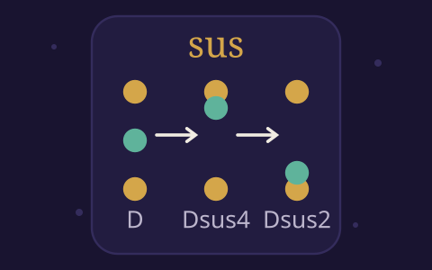

# sus y add9

**Sin 3ª o con una más** · teoría · 6 min

Aprende qué hacen sus2, sus4 y add9: qué nota reemplazan o suman, cómo se resuelve un sus4 y en qué se diferencia el sus2 del add9.

## Objetivo

Armar y reconocer sus2, sus4 y add9, y explicar qué pasa con la 3ª en cada uno.

## Contenido

1. **sus.** Reemplaza la 3ª por la 2ª (sus2) o la 4ª (sus4).
2. **add9.** Conserva la 3ª y suma la 9ª, sin 7ª.
3. **Resolver.** El sus4 vuelve al mayor: la 4ª baja medio tono a la 3ª.
4. **Cómo se escriben.** Dsus2, Dsus4, Dadd9, Dmadd9 y G7sus4.

## Actividad

Diez preguntas: las notas de cada acorde, qué nota desaparece, qué nota baja al resolver, si conserva la 3ª y de oído.

## Licencia

CC BY 4.0, con crédito a Acordia (SAÚL música).
