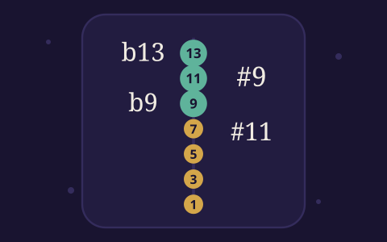

# Tensiones

**9, 11, 13 y las alteradas** · teoría · 7 min

Aprende las notas por encima de la 7ª y cómo se alteran: qué son la 9ª, 11ª y 13ª, y qué notas son b9, #9, #11 y b13.

## Objetivo

Nombrar la nota de cada tensión (9, 11, 13) y de cada alteración (b9, #9, #11, b13), y reconocer los acordes que las llevan.

## Contenido

1. **Tensiones.** La 9ª, 11ª y 13ª son la 2ª, 4ª y 6ª una octava arriba.
2. **Alteradas.** b9 y b13 bajan medio tono; #9 y #11 suben medio tono.
3. **11ª.** Choca con la 3ª mayor: se usa con menores o subida (#11).
4. **Paréntesis.** Acordia las agrupa: G7(b9), G7(b9,#11,13).

## Actividad

Diez preguntas: qué nota es cada tensión o alteración, las notas de cada acorde y qué acorde forman unas notas.

## Licencia

CC BY 4.0, con crédito a Acordia (SAÚL música).
